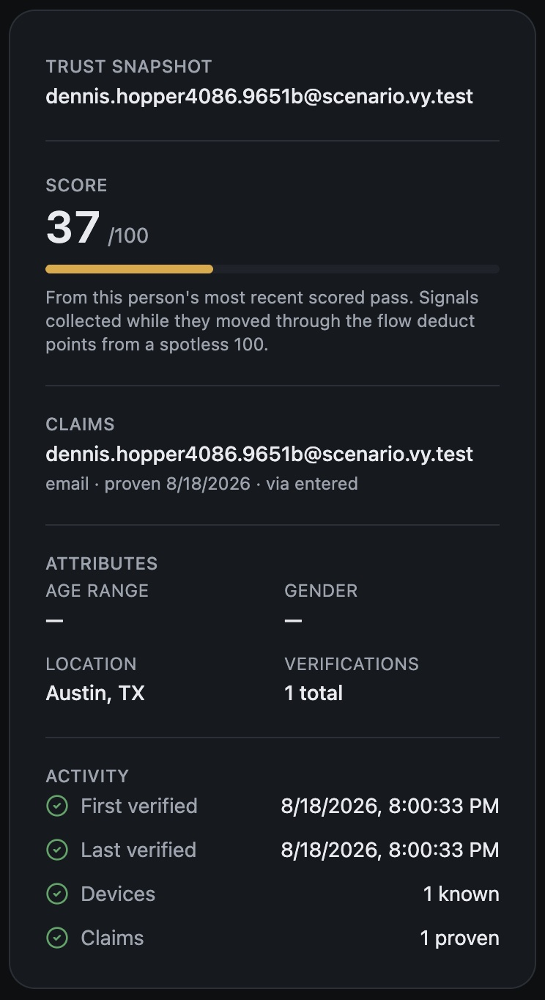
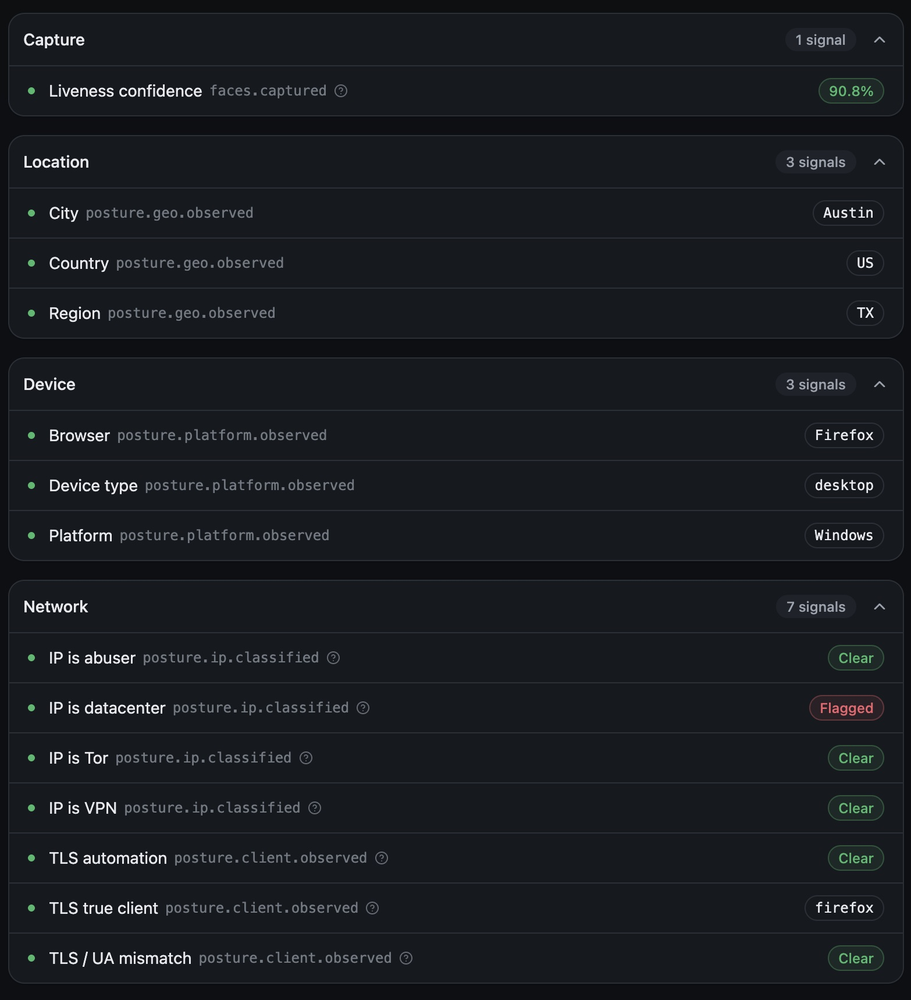

{/*
REBUILT 2026-08-21 at James's request: cover the per-user drill-in properly, with the trust score
explained and, more to the point, how to use it.

NOT A NEW PAGE, deliberately. This IS the drill-in page, and
docs/insights/threat-levels-and-signals owns the population view and the trust-against-threat
relationship. A third page would have duplicated both, which is what we have spent the day
removing.

FROM SCREEN, live account and the demo:
  Header "Person" plus a short id. Tabs: Overview · Signals · Flags · History, and a fifth tagged
  Soon.
  TRUST SNAPSHOT: "SCORE 45 /100", and under it, verbatim: "From this person's most recent scored
  pass. Signals collected while they moved through the flow deduct points from a spotless 100."
  ATTRIBUTES: age range, gender, location, verifications total.
  ACTIVITY: first verified, last verified, devices known, claims proven.
  Signals tab: filter by High / Medium / Low signal, five categories with counts, e.g. Capture 2
  signals (liveness attempts 1, liveness confidence 100%), Person 3, Location 2, Device 4,
  Network 7.
  Flags empty state: "Nothing flagged for this person. Every run they made came through clean."

THE FACT THAT MAKES THIS PAGE WORTH WRITING: the score is from ONE run, the most recent scored
pass, and the panel says so in small type that nobody reads. Anybody treating it as a standing
rating of a person is misreading it. Nothing on the site said this before.

RETITLED "Per user drill in" 2026-08-21, James. Slug stays /docs/activity/guest-profiles so
nothing already linked breaks. Note the product headers the view **Person**, so three words are
now in play for the same thing: our title, the product's header, and the old Guest. The body uses
the product's.

RETITLED "Comprehensive trust score" 2026-08-21, James, from "Per user drill in". Slug still
/docs/activity/guest-profiles. "Comprehensive trust score" is his phrase and it is already in
learn/intro-to-verifyyou, so it is company language rather than something invented for the nav.
The description is his too: "how we use active and passive signals to protect your platform". He
wrote "passive and active and passive"; the repetition is a slip and is fixed. Active and passive
signals is the pairing article 1 already uses.

SIGNAL CATEGORIES ADDED from the list David emailed Neha Purswani at CINT on 14 Aug (thread
19ffbf880ab07dbe), cross-checked item by item against the Activity filter and the person view.
Only what is verifiably in the product went in.

⚠️ WHAT IS IN THAT EMAIL AND NOT IN THE PRODUCT. Flag to David before the next send:
  1. "Location diff, so if someone enrolls in one country and later appears from another, you see
     it." Not shipped. Blake's Site Check call has it as coming soon and the Aug 19 scan has no
     such control.
  2. "How many partner companies in our network have seen this person" and "whether they have
     been flagged elsewhere in the network". claim-gates.md says plainly that a technical reader
     who asks to SEE a partner count or a flagged-elsewhere signal will not find one in the
     dashboard.
  3. The threat families are given as "network, velocity, automation, liveness and identity".
     That is the old taxonomy. The live product checks network, geography, accounts, automation
     and liveness.
The same email also carries per-verification pricing and a pilot allowance, which is David's to
give and must never reach these pages.

A second version of the same email went to Kurt Schulze at NewtonX (thread 19ffe7457eec1abc) and
adds "Race and ethnicity. We can return a signal on this". James excluded it explicitly and it is
not in these docs. It should not go in without legal sign-off.

SHORTENED the same hour, James: 482 to about 330. What went was the email-trail caution (it is on
no other page, so if it matters it needs a home), the two-patterns paragraph's second half about
baselines, and the History column list, which the glossary carries.

FACE SIMILARITY ADDED 2026-09-29 (VY-1250): one short section pointing at
docs/activity/face-similarity, which owns the detail. It is flag-gated per workspace, hence
"where your workspace has it".

DELIBERATELY ABSENT: Override. Not on screen in either scan, and the row menu on Activity offers
Open profile and nothing else.

DRIFT FIX 2026-11-18. PR #75's 2026-11-16 walk found "the person page replaces the old trust
score section" and "no 100 point trust score on screen". Checked directly against the current
product source: the person page carries no score field at all, and signals are grouped
**Identity, Connection, Device, Email, Behavior (beta) and Passive (beta)**, each read with a
pip as pending, no data, normal, or abnormal rather than scored. The Capture / Person / Location
/ Device / Network five-category model and the SCORE /100 panel this page described do not
exist in the current source. The score and category sections below are rewritten to what is
confirmed; the exact tab layout (whether Overview / Signals / Flags / History tabs still exist
as such) was not re-walked on screen, so that structure is left as UNVERIFIED rather than
guessed, and the screenshots below are stale and should be re-shot.
*/}

Clicking a row in Activity opens the person behind it.

We collect two kinds of signal on every check. Active ones come from the person in front of the camera: whether the face is live, how confident we were, whether we have seen it before. Passive ones come from everything around them: the IP and where it resolves to, the device and browser, how often they have appeared and how fast.

<Frame caption="The panel beside every tab. [STALE: pre-dates the signal-group rename; re-shoot]">
  
</Frame>

## What we saw: the Signals tab

**Signals** is the evidence, grouped into six categories: **Identity**, **Connection**, **Device**, **Email**, **Behavior** and **Passive**, the last two marked beta. Each signal reads as pending, no data, normal, or abnormal rather than as a score, and you pick which signals show on every person in **Settings**, under **Signals**.

<Frame caption="The Signals tab, grouped into categories. [STALE: screenshot pre-dates the current grouping; re-shoot]">
  
</Frame>

**Identity** covers who this person claims to be and what is proven, such as an email or phone bound to them.

**Connection** is about the network a session came through: whether the IP is a VPN, a datacenter, a Tor exit, or already known for abuse, and whether it behaves like the browser it claims to be.

**Device** is the platform, device type and browser. One person across several devices is normal. Several people on one device is not.

**Email** covers what we know about the address itself.

**Behavior** (beta) and **Passive** (beta) read from how someone moves through a page, before and during the check. See [Passive Signals](/learn/passive-signals) for what the passive layer reads.

## What we flagged: the Flags tab

Anything our checks raised on this person, with the reason attached. Empty means every run came through clean rather than nothing being looked at.

## Where they have been: the History tab

Every confirmation this person appears in, newest first, including runs where they are only the evidence. A denial shows its reason inline, so `limit reached` tells you your own limit fired.

This is the tab that gives you a baseline. One abnormal run from a first-timer is thin. One abnormal run from somebody with twelve clean ones behind them is a change, and changes are what you want to catch.

## A photo you hold: Face similarity

Where your workspace has it, a **Face similarity** card sits under the tabs. Upload a selfie or photo ID you hold for this person, and it tells you whether that face is the one behind their HumanChecks. Past assessments are listed on the History tab. See [Face similarity](/docs/activity/face-similarity).

## Who they are to you: the summary panel

**Claims** is the field to read first. It names the phone or email bound to this person, when it was proven and how. If there is one, this person can be recognised on any device, anywhere you run a check. If there is not, recognition stops at the device they used, and they will look new the next time they arrive on another one.

**Attributes** repeats the estimates from the scan alongside how many HumanChecks they have with you in total.

**Activity** is their span with you: when they first and last took a HumanCheck, and how many devices we have seen them on.

**Next:** [Face similarity](/docs/activity/face-similarity)
