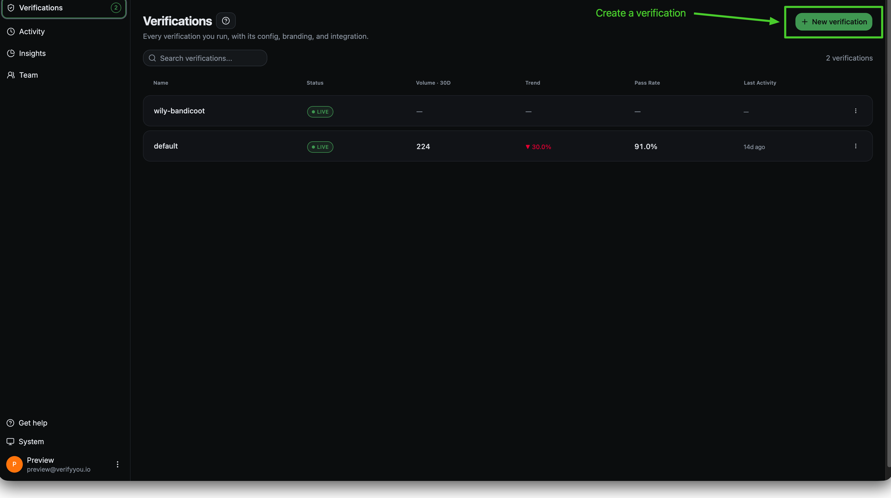

{/*
Written 2026-08-21 from DASHBOARD_REFERENCE.md, which walked the wizard on screen. Short on
purpose: every step here has a page of its own, and this page's job is to say what the step is
for so nobody has to guess mid-wizard. Drift item 5 in the reference: the old guides page
described a three-field form. This replaces it.

DUPLICATE SECTION added 2026-09-09, then verified the same day in the livetest workspace: the
row menu on the Verifications page (aria label "Verification actions") holds View details,
Rename, Duplicate, Copy link, Delete. The section names the menu by position, not by an
on-screen label, because the button is an unlabeled kebab.

DRIFT FIX 2026-11-18. The product renamed "Verifications" to HumanChecks: the nav item is
HumanChecks at /dashboard/humanchecks, and the New button reads "New HumanCheck". The old
/dashboard/verifications URL still works (it redirects to /dashboard/humanchecks), but the page
and button people actually see say HumanCheck, so the prose and the link now match that. The
four presets below were re-checked and are unchanged. The row-menu duplicate section was not
re-walked; left as is.
*/}

Creating a HumanCheck is simple, and you can create as many as you like for different use cases on your platform. Each one carries its own settings, so a strict check before a payout and a light one at signup run side by side.

Start from [**New HumanCheck**](https://platform.verifyyou.com/dashboard/humanchecks?new=true) on the HumanChecks page. Five steps, in this order.

<Frame caption="The HumanChecks page. New HumanCheck, top right, starts the wizard. [STALE: screenshot predates the HumanCheck rename and should be re-shot]">
  
</Frame>

<Steps>
  <Step title="Get started">
    A short orientation to what you are about to set up. Nothing to fill in, so click through it.
  </Step>
  <Step title="Pick your check">
    Choose a preset: **Signup Gate**, **Account Sweep**, **AI Data Labeling Fraud Audit** or **Build Your Own**. Then choose your integration method, **No-code** for a link you share, or **Code** for the SDK.
  </Step>
  <Step title="Branding">
    Company name, which people see as "Verifying you for [name]". A logo is optional. See [Branding your check](/docs/verifications/branding-your-check).
  </Step>
  <Step title="Tune your check">
    We make tuning the check for your use case easy with [Configuration](/docs/verifications/configuration), which sets how the check behaves: Can the same human pass twice? Do returning users under a different account get allowed, blocked, or flagged for your team's review? Do you tie each human to an email, phone number, or neither?

    Questions like these all have a simple solution. [Book a demo](https://sales.verifyyou.com) to walk through this with our team.
  </Step>
  <Step title="Integrate">
    No code or code, based on your resource allocation and your use case. No code gets you started with zero developer effort, so you can prove value early without interrupting your roadmap. See [Integration](/docs/verifications/integration).
  </Step>
</Steps>

The preset only sets the starting point. Everything it chose stays editable on the Configuration tab afterwards, and saving there applies to the live check straight away.

## Reuse one you have already tuned

A check you have spent time getting right does not have to be rebuilt to be reused. On the [HumanChecks page](https://platform.verifyyou.com/dashboard/humanchecks), open the menu at the end of the check's row and choose **Duplicate**. The setup carries over into a new check under its own label. Adjust what needs adjusting and take it live.

**Next:** [Configuration](/docs/verifications/configuration)
